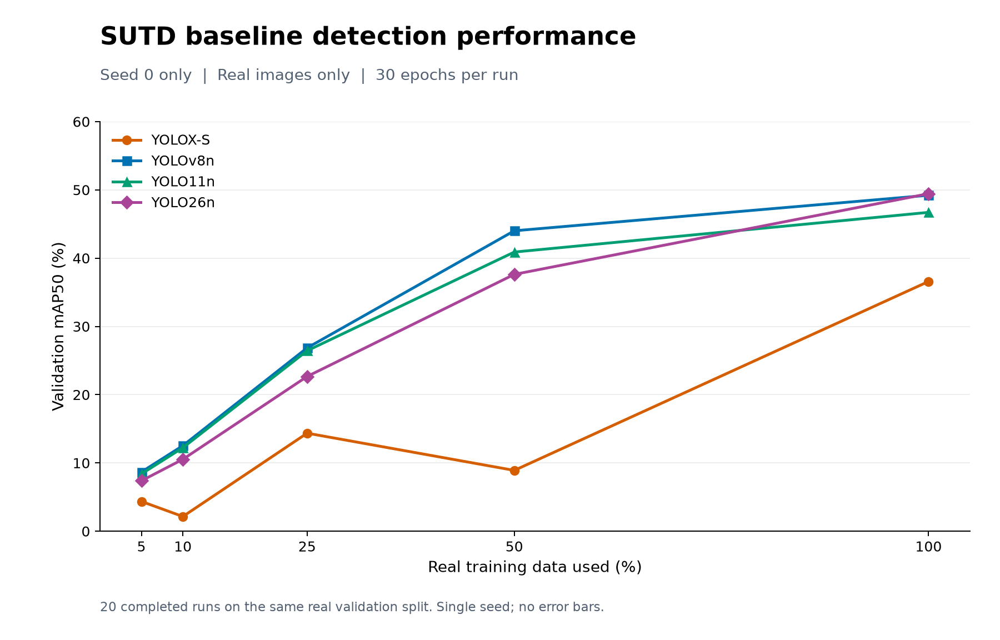

# SUTD baseline results — seed 0

Generated: 1 November 2026 (Asia/Dubai).

All 20 baseline runs are complete: four detectors across five real training-data fractions. These results use real images only, no GAN or classical augmentation, 30 epochs per run, and last-epoch checkpoints. Seeds 1 and 2 are excluded.

All scores below are percentages. Precision and recall use confidence 0.25 and matching IoU 0.5. Evaluation uses the same 98 real validation images; these are not reserved-test results.

## Validation metrics

| Real data | Model | Real images | mAP50 (%) | mAP50–95 (%) | Precision (%) | Recall (%) |
|---|---|---:|---:|---:|---:|---:|
| 5% | [YOLOX-S](../runs/seed0_f00500__baseline__yolox/val/metrics.json) | 34 | 4.36 | 1.84 | 5.78 | 13.74 |
| 5% | [YOLOv8n](../runs/seed0_f00500__baseline__yolov8/val/metrics.json) | 34 | 8.67 | 2.82 | 50.79 | 5.86 |
| 5% | [YOLO11n](../runs/seed0_f00500__baseline__yolo11/val/metrics.json) | 34 | 8.39 | 3.02 | 46.15 | 5.49 |
| 5% | [YOLO26n](../runs/seed0_f00500__baseline__yolo26/val/metrics.json) | 34 | 7.39 | 2.77 | 40.82 | 3.66 |
| 10% | [YOLOX-S](../runs/seed0_f01000__baseline__yolox/val/metrics.json) | 68 | 2.15 | 0.58 | 14.22 | 6.04 |
| 10% | [YOLOv8n](../runs/seed0_f01000__baseline__yolov8/val/metrics.json) | 68 | 12.53 | 3.95 | 47.66 | 11.17 |
| 10% | [YOLO11n](../runs/seed0_f01000__baseline__yolo11/val/metrics.json) | 68 | 12.23 | 3.96 | 45.31 | 10.62 |
| 10% | [YOLO26n](../runs/seed0_f01000__baseline__yolo26/val/metrics.json) | 68 | 10.53 | 3.50 | 32.80 | 11.17 |
| 25% | [YOLOX-S](../runs/seed0_f02500__baseline__yolox/val/metrics.json) | 172 | 14.36 | 4.34 | 32.35 | 18.13 |
| 25% | [YOLOv8n](../runs/seed0_f02500__baseline__yolov8/val/metrics.json) | 172 | 26.85 | 9.60 | 56.36 | 28.39 |
| 25% | [YOLO11n](../runs/seed0_f02500__baseline__yolo11/val/metrics.json) | 172 | 26.43 | 8.51 | 52.63 | 27.47 |
| 25% | [YOLO26n](../runs/seed0_f02500__baseline__yolo26/val/metrics.json) | 172 | 22.67 | 7.58 | 47.59 | 25.27 |
| 50% | [YOLOX-S](../runs/seed0_f05000__baseline__yolox/val/metrics.json) | 344 | 8.91 | 2.63 | 46.43 | 9.52 |
| 50% | [YOLOv8n](../runs/seed0_f05000__baseline__yolov8/val/metrics.json) | 344 | 44.00 | 16.20 | 62.24 | 44.69 |
| 50% | [YOLO11n](../runs/seed0_f05000__baseline__yolo11/val/metrics.json) | 344 | 40.89 | 14.50 | 59.05 | 43.04 |
| 50% | [YOLO26n](../runs/seed0_f05000__baseline__yolo26/val/metrics.json) | 344 | 37.62 | 13.57 | 55.12 | 43.41 |
| 100% | [YOLOX-S](../runs/seed0_f10000__baseline__yolox/val/metrics.json) | 688 | 36.58 | 12.38 | 45.50 | 48.17 |
| 100% | [YOLOv8n](../runs/seed0_f10000__baseline__yolov8/val/metrics.json) | 688 | 49.21 | 19.26 | 60.43 | 51.47 |
| 100% | [YOLO11n](../runs/seed0_f10000__baseline__yolo11/val/metrics.json) | 688 | 46.70 | 18.41 | 62.87 | 50.55 |
| 100% | [YOLO26n](../runs/seed0_f10000__baseline__yolo26/val/metrics.json) | 688 | 49.44 | 19.28 | 59.33 | 54.76 |

## Interpretation

- At 100% real data, YOLO26n achieves 49.44% mAP50 and YOLOv8n achieves 49.21%. This single-seed difference does not establish a reliable ranking.
- YOLOX-S has a non-monotonic curve, including a drop at 50% real data. That observation needs investigation rather than an assumption that more real data is harmful.
- No across-seed error bars or significance claims are made. Dataset annotations remain provisional.
- YOLOX-S and the nano models differ in size and training implementation; this is a comparison under the configured recipe.

## Provenance

Source plan identity: `e0426be7415103f859c7f1a57d58e49940c15cd955eb0512f84f7b59175c681e`.

Each linked metrics file is the source for its table row. The plot data are retained in [baseline_seed0_plot_data.json](baseline_seed0_plot_data.json). This filtered report is separate from the multi-seed study report and does not modify training inputs or execution state.
